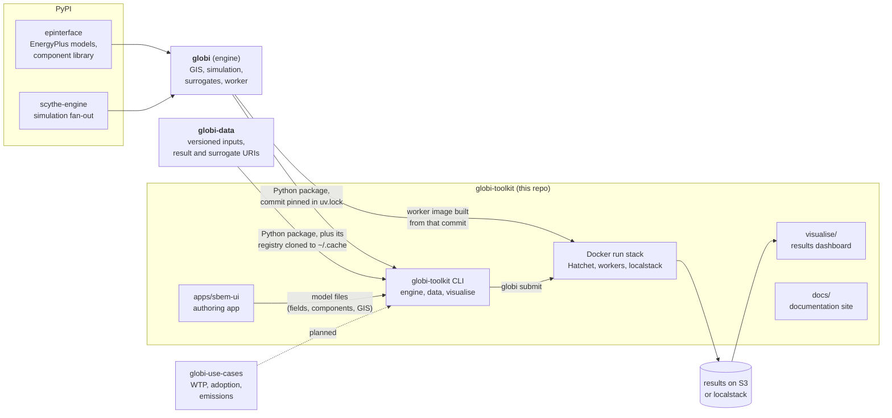

# globi-toolkit

The main entry point for the Global Building Inventory (GloBI). It pulls the GloBI
components together so you can author inputs, run simulations, fetch results, test use
cases and visualise outputs from one place. The toolkit itself holds glue, not domain
logic: modelling lives in the engine, data lives in globi-data.

## How the repos fit together



The dashed link is planned. Clone only this repo: the engine and globi-data arrive as
packages pinned in `uv.lock`, the worker image is built from the same engine commit, and
globi-data's registry is cloned on first use. epinterface and scythe come in through the engine. Result URIs go
back into globi-data with `globi-toolkit data outputs record`.

## Stages and where each comes from

| Stage | Role (UBEM.IO) | Provided by | Status |
|---|---|---|---|
| **author** — semantic fields, component library, priors, retrofits | energy modeler | sbem-ui, in `apps/sbem-ui/` | in this repo |
| **ingest GIS** — footprints, height, type, age | GIS manager | `globi` engine (`globi.gis`) | dependency |
| **run** — partner × scenario × weather registry on top of `globi submit` | energy modeler | moves here from globi-partners-data `experiments/` | planned |
| **surrogate** — training config, inference on a whole stock, recording in globi-data | energy modeler | toolkit; training itself stays in the engine | scoped, see [MIGRATION.md](MIGRATION.md) |
| **validate** — against metered data, calibration | all | `globi.validation`, globi-uk-calibration | later |
| **fetch** — versioned inputs, result and surrogate URIs | all | [globi-data](https://github.com/MITSustainableDesignLab/globi-data) | dependency |
| **analyse** — WTP, adoption, emissions | sustainability champion | [globi-use-cases](https://github.com/daryaguettler/globi-use-cases) | planned (needs a proper package) |
| **visualise** | sustainability champion | results dashboard, in `src/globi_toolkit/visualise/` | in this repo |

The documentation site lives here too (`make docs`); see [MIGRATION.md](MIGRATION.md) for what moved from the engine.

## Setup

```bash
uv sync
uv run epinterface prisma generate   # one-time, for the component library (or: make install)
uv run globi-toolkit info            # prints installed versions of each component
uv run globi-toolkit engine --help   # the engine's CLI (submit, simulate, get, tests)
uv run globi-toolkit data inputs list  # the globi-data CLI; first use clones globi-data into ~/.cache
```

## Run simulations locally

Everything runs from this repo; no engine checkout is needed. `make help` lists all targets.

```bash
make hatchet-token   # start Hatchet and write its token to .env.local*.hatchet
make engine          # build the worker image from the engine commit in uv.lock, start the stack
make ps              # check the containers
make viz-native      # results dashboard on http://localhost:8501
make down            # stop everything
```

The worker image is about 6 GB and the build downloads EnergyPlus; the dashboard image
is about 5 GB. The stack uses the same ports as the engine repo's stack (8888, 7077,
4566, 5672), so stop one before starting the other. Tutorials are in the docs
(`make docs`).

`globi-toolkit data` reads globi-data's registry from a shallow clone in
`~/.cache/globi-toolkit/globi-data` (`globi-toolkit data pull` updates it). To publish or
record versions, point it at your own checkout with `GLOBI_DATA_ROOT` or `--root`.

`globi` and `globi-data` install from their `main` branches; `uv.lock` records the
exact commits, so the lockfile is the one place where component versions are known to
work together.

## Authoring inputs with sbem-ui

sbem-ui is a Svelte + FastAPI app in `apps/sbem-ui/`, a uv workspace member: `uv sync`
installs its Python side with everything else. The frontend needs Node 18+. It writes the
files GloBI runs (`semantic-fields.yaml`, `component-map.yaml`, `components-lib.db`, priors,
retrofits) and runs GloBI through this repo's `make cli-native` / `make cli`.

```bash
make ui-setup   # once: frontend packages
make ui         # backend on :8000, app on http://localhost:5173
make test-ui    # sbem-ui's tests
```

Create projects under `inputs/` so Docker runs can see them. Single Building runs need the
engine's `simulate-flat` command, which is not on globi main yet.
